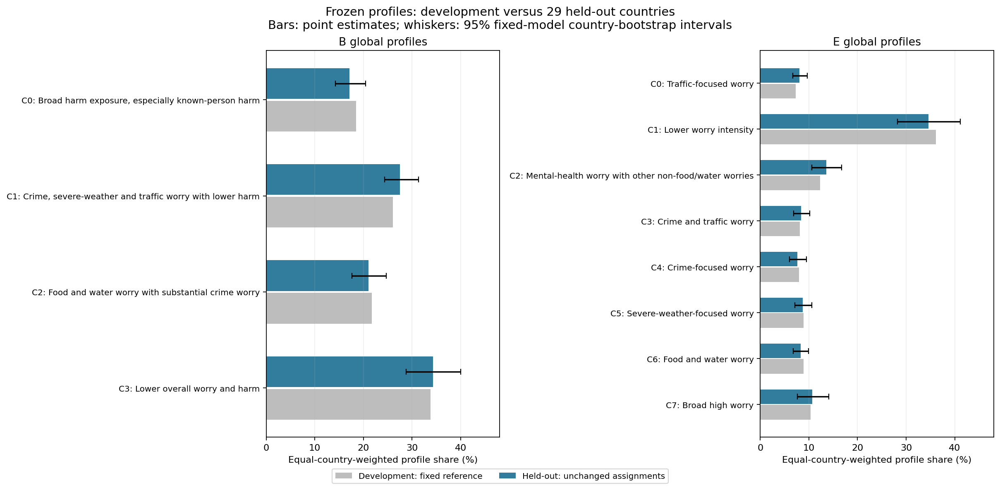
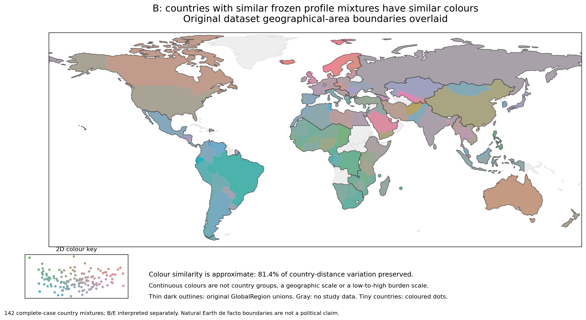

# Results through Week 5

This release records completed results as of 12 October 2026. Current final conclusions take precedence over older experiment folders, which are retained as an audit trail.

## Week 3 — A useful baseline, not a frozen typology

Equal-country-weighted K-means explored k=2,…,10 on median-imputed, standardized development profiles. The notebook tracks inertia, silhouette, Calinski–Harabasz, Davies–Bouldin, cluster sizes, initialization stability and country-block Prediction Strength. Burden reconstruction and grouped five-fold single-feature reconstruction tested whether profiles were merely simple response rules.

The retained k=4 water-harm cluster was particularly reconstructible: the selected single-feature rule achieved about 98.8% balanced accuracy, 85.2% precision and 100% recall. This is a warning about interpretation, not evidence that more clusters are necessarily better. Week 4 changed the representation and eligibility rather than freezing this baseline.

Authoritative starting notebook: [Week 3](../weekly_notebooks/week03_prepare_the_2023_analysis_data_v16.ipynb). Aggregate tables use the `week03_` prefix; `week03_v11` holds additional reconstruction diagnostics.

## Week 4 — Two complementary K-means descriptions and a Ward corroboration

The complete-case experiments compare worry coding, block allocation and personal versus known-person harm. Final B4 and E8 use separate harm with six relative worry coordinates plus a reduced overall-worry coordinate.

| Model | Respondent ARI median / lower decile | Country ARI median / lower decile | Largest weighted cluster |
|---|---|---|---|
| B4: balanced, 0/1/2 | 0.960 / 0.921 | 0.930 / 0.856 | 33.8% |
| E8: worry-emphasized, 0/1/3 | 0.898 / 0.835 | 0.863 / 0.816 | 36.1% |
| Ward k=8: worry-emphasized, 0/1/3 | 0.943 / 0.888 | 0.929 / 0.860 | 34.8% |

B4 captures broad harm exposure, crime/weather/traffic worry with lower harm, food/water worry and lower overall worry/harm. E8 differentiates thematic worry configurations. Exact stored IDs and descriptions are in [the frozen models](../frozen_models/models.json).

The alternative-method search screened **288 reference specifications**: **265 successful references**, **23 DBSCAN computational failures**, and **60 structurally eligible references**. The eligible set received 6,000 successful stability fits. Only Ward candidate 170 passed every retention rule. GMM and average linkage produced no retained candidate; DBSCAN produced no structurally eligible reference. These are conclusions about the tested settings and pipelines, not all possible uses of those methods.

Ward versus E has ARI **0.820**, with **82.3% optimally matched membership**. This supports a recognizable thematic structure while leaving materially different boundaries. Shared Euclidean geometry and centroid-based extension partly explain why agreement is plausible; this is not independent-method proof of latent social types. Ward versus B has ARI 0.245. The B/E/Ward approximate-refinement graph has no strong edges under the declared purity rules.

Authoritative folders:

- `course_artifacts/week04_experiment1_complete_overall_worry_v3/`: final complete-case K-means encoding/weight experiments, stability and overlaps.
- `course_artifacts/week04_other_algorithms_v1/`: all alternative reference screens, failure records, stability and B/E comparisons. The folder’s version label identifies provenance; it does not imply an unfinished experiment.

Other `week04_*` folders document earlier search stages. Their labels, eligibility and provisional selections must not be substituted for B4/E8.

## Week 5 — Global profiles are useful without being universal regional optima

Global frozen-profile prevalence and original-unit meaning are reported globally, within every dataset region and by country. Independently optimized regional models often choose a different resolution, including stable binary splits. The local-resolution extension completed **10,456 stability fits without failures**. Fourteen region/model/resolution cases met both full stability benchmarks: seven binary diagnostic cases and seven with k≥3.

This does not automatically invalidate the global profiles: a common global coordinate system and a locally optimal description answer different questions. It does rule out claiming that exactly the same rich typology is recovered independently in every region. Small numbers of countries, repeated country subsets, per-profile recovery and original-response semantics are important qualifications. The 0.80 threshold was retained, not lowered to manufacture richer regional solutions.

Authoritative folders:

- `course_artifacts/week05_regional_validation_v3/7c24b461bbb895b5/`
- `course_artifacts/week05_local_resolutions_v4/f3145c704f52c156/`

The regional v1 folder is historical; v3 and the local-resolution extension support the final conclusions.

## Held-out-country transfer

Frozen B4/E8 assign **27,972 of 30,090 respondents (93.0%)** in 29 held-out countries. Exclusions are transparent: one respondent has no observed profile answer, 202 have too few observed worry/harm domains, and 1,915 have remaining missing profile answers. Excluded respondents remain unassigned; they are not filled entirely through imputation.

All **36 prespecified development anchor contrasts** retain their direction in the aggregate held-out cohort. Prevalence and response distributions remain interpretable. However, preserved anchors partly reflect the fixed geometry and are not an independent significance test. Some E profiles had weak development cluster-recovery lower tails despite passing whole-partition ARI.

Held-out distance-flag rates are **6.34% for B** and **5.44% for E**, with material concentration in Sierra Leone, Somalia and Namibia. The other 26 countries average approximately 4.49% and 4.53%, respectively; all 29 remain in the official results. Distance flags diagnose poor representation relative to development, not proof of a new cluster or an automatic model rejection.

The conclusion is **broad aggregate descriptive transfer with important country-specific limitations**, not unrestricted success. Complete-case selection, equal-country weighting, fragile E boundaries and small country/profile cells remain explicit cautions. Do not treat small cells as precise population estimates.

Authoritative folders:

- `course_artifacts/week05_frozen_objective1_v1/123d248adda6115f/`: original specification and aggregate development evidence.
- `course_artifacts/week05_heldout_transfer_v1/123d248adda6115f/`: transfer tables, uncertainty, exclusion audits and final evidence inventory.
- `frozen_models/`: readable centres and assignment code, containing no training respondents.

## Country similarity and the maps

Country distances use proportions across the **same frozen global profiles**. This avoids pretending that independently fitted local cluster numbers have matching meanings. Within-region distances are smaller on average than between-region distances, but many closest countries are outside the same region. This is descriptive similarity of profile mixtures, not equivalence of countries or a causal geographic effect.

The map offers two views. **Overview** colours are a two-dimensional approximation of the original Hellinger geometry: 81.4% of country-coordinate variation is displayed for B and 73.6% for E. Colours cannot reliably identify the nearest country. **Distance from selected country** uses the original Hellinger distance directly. The ranked lists also use original distances and show 10, 20 or all 141 other countries. Region outlines use the existing dataset regions.

Exploratory country-tree cuts and 200 conditional respondent bootstraps did not justify adopting a new country typology. Burden-only lookup reconstructs only approximately 63% of B and 52% of E membership, illustrating information lost by reducing domain composition to two totals; this is an in-sample descriptive ceiling, not out-of-sample predictive performance.

Authoritative folders:

- `course_artifacts/week05_country_similarity_and_profile_synthesis_v1/d694096841b06e54/`
- `course_artifacts/week05_continuous_country_similarity_maps_v1/`
- [Offline interactive map](../docs/index.html)

## What is frozen, and what comes next

Objective 1 is closed with B4 as the stronger core description and E8 as a complementary thematic description. Subsequent objectives use these centres and stable profile IDs. No clustering was refitted on all countries: a full-data refit would define a new model not validated by the already-used held-out countries. Objectives 2–4 require new work and are not claimed as results here.
