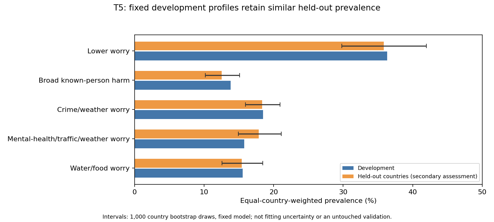
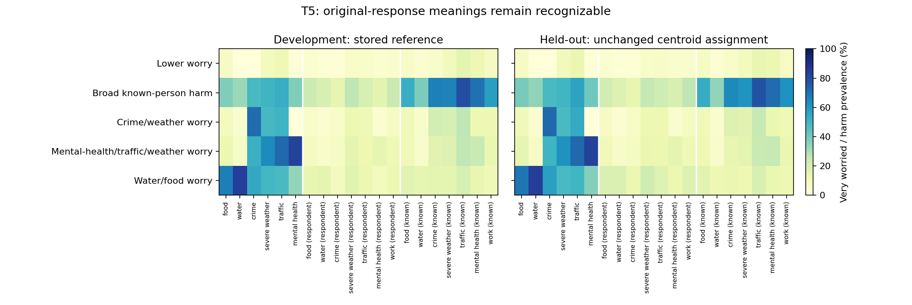

# WARM-5: five-profile model — 17 October 2026

Decision and scope. WARM-5 is the frozen model presented in this release: k=5, q=0.41670089020376244, t=2.399802888616365, alpha=0.5837857862168715. Stored IDs T5_C0–T5_C4 preserve centre order. Every webpage and final-results download uses WARM-5. There is one allocation: worry 58.38%, personal harm 20.81%, known-person harm 20.81%. Component views are not alternative clustering models.

Shallow explanations. All five country-grouped folds were used. With the two original-unit burden scores, depths 1/2/3 achieved mean balanced accuracies 32.7%, 46.0% and 51.2%. The additional trees supplied with all 20 original features achieved 36.8%, 54.0% and 67.9%; depth 5 reached 73.7%. At depth 3, broad known-person-harm recall was only 19.3%, despite high recall for lower worry. These trees capture useful patterns but do not nearly reconstruct the entire typology. The strongest single-feature rule uses water worry, with balanced accuracy 88.3%, precision 67.4% and recall 84.3%. This is an informative marker, not a near-unique cluster definition. A depth-1 multiclass tree has at most two leaves and depth 2 at most four: for five nonempty classes their balanced-accuracy ceilings are 40% and 80%. Low shallow scores alone therefore cannot prove complexity. No new automatic rejection cutoff was introduced. Ordinary greedy Gini trees were used; this does not rule out every possible optimized rule set or establish that the profiles are natural latent types. The fixed cluster labels were originally learned using all development countries, so this cross-validation assesses explanatory fidelity, not fully independent clustering generalization.

Transfer population. Apply the sealed centres to 27,972 complete respondents from all 29 held-out countries. The other 2,118 of 30,090 respondents remain unassigned because of missing profile responses. A separate ID-linked WARM-5 handoff includes all 146,910 prepared respondents: 137,460 assigned and 9,450 excluded. Do not fill excluded labels, join by row order, or renumber the frozen profile IDs.

Prevalence. Development to held-out equal-country shares are: Lower worry 36.3% to 35.9%; Broad known-person harm 13.8% to 12.5%; Crime/weather worry 18.5% to 18.3%; Mental-health/traffic/weather worry 15.8% to 17.9%; Water/food worry 15.5% to 15.4%. Different prevalence is allowed and was not used to retune the model.

Profile identity. All 15/15 development-selected anchor directions remain positive in aggregate held-out data. Mean feature total variation within profiles ranges from 0.0083 to 0.0281; the largest single-feature difference is 0.0554. This measures original-category distribution shifts, not centroid distances, ARI, or a newly defined pass/fail score. Semantic retention partly follows from assigning people using these same features; it supports portability of this fixed description, not independent discovery of the same groups.

Assignment quality. Overall median distance changes by a factor 1.0048; median assignment margin changes from 0.1515 to 0.1524. The fraction beyond the assigned-profile development distance p95 changes from 4.95% to 5.69%. Flags identify less typical assigned responses, not unassigned cases, misclassification probabilities or an overall rejection rule.

Country limitations. The largest distance-flag fractions are Sierra Leone 18.8% (complete-response retention 78.7%); Namibia 16.9% (complete-response retention 94.4%); Somalia 16.7% (complete-response retention 82.9%). Global averages conceal these weaknesses. Country/profile tables include respondent counts and Kish weighted effective sizes; very small groups have uncertain conditional descriptions. For example, Sweden's water/food group contains only 15 respondents (Kish effective size 9.8), so its mean feature total variation of .200 is poorly estimated. Somalia's water/food group has mean feature total variation .225 with 173 respondents (effective size 138.8): this is a substantive country-specific shift that cannot simply be dismissed as a 15-person group. These examples qualify any claim that all five profile meanings reproduce equally well in every country. Complete-case selection may change apparent country profiles; the assessment does not establish representativeness of respondents excluded for missing answers.

Uncertainty and conclusion. The 1,000 country bootstrap intervals keep the model fixed and preserve relative survey weights within each sampled country. They describe variation over these 29 observed countries, not all-world sampling, respondent nonresponse, model fitting or parameter-selection uncertainty. The results support broad aggregate descriptive transfer of WARM-5, with material country-specific qualifications. No automatic numerical transfer criterion had been specified; this is an analytical synthesis using the frozen-assignment diagnostics. The held-out countries had been inspected before WARM-5 selection. This must be reported as secondary transfer assessment, not pristine external confirmation. At the transfer stage, no new local-region clustering, independent held-out clustering or all-data refit was performed. The 17 October extension below adds development-only regional fits; the global model remains fixed. T8 remains exploratory, not a co-equal main model.

## Evidence and reuse

- [Evaluation completion and publication scope](../course_artifacts/week05_t5_secondary_transfer/832b01713bc6b240/evaluation_finalization.json).
- [Week 5 workflow](../weekly_notebooks/week05_validate_frozen_profiles.ipynb): grid search, adaptive extension, fresh confirmation, profile review, selection, freeze and secondary transfer.
- [Exact readable model](../frozen_models/T5_models.json). Stored IDs are T5_C0 through T5_C4; preserve their order.
- [Transfer summary](../course_artifacts/week05_t5_secondary_transfer/832b01713bc6b240/profile_transfer_summary.csv).
- [Original held-out categories](../course_artifacts/week05_t5_secondary_transfer/832b01713bc6b240/heldout_original_category_profiles.csv).
- [Country quality and retention](../course_artifacts/week05_t5_secondary_transfer/832b01713bc6b240/heldout_country_quality_and_retention.csv).
- [Profile-level country shifts and sample sizes](../course_artifacts/week05_t5_secondary_transfer/832b01713bc6b240/heldout_profile_semantic_differences.csv).
- [Verification](../course_artifacts/week05_t5_secondary_transfer/832b01713bc6b240/verification.json).

The public package intentionally excludes respondent-level handoffs, label arrays,
sampling indices and fit caches. Model centres alone permit assignment of complete
responses when survey data are supplied separately; no all-country refit is needed.
Country maps now include WARM-5. Week 6 predicts WARM-5 membership; the manuscript is maintained separately.

## WARM-5 geographical completion — 17 October 2026
WARM-5 regional completion: 6 cases pass both full stability tests; 0 failed stability fits. Small-region LOO and respondent-only diagnostics are not full geographic confirmation. Global WARM-5 was not refitted.

The same frozen WARM-5 geometry is used for all independent regional fits. The regional protocol selects alternatives without using agreement with the global labels. Country mixtures, region-wise original responses, 200 conditional respondent bootstraps, exploratory country groups, original-response distances and 999 whole-country income-label permutations are saved. Small regions have limited or unavailable country tests. Global profiles, local profiles and country groups must not be treated as the same objects.

Country original-response distance gives worry alpha=0.5837857862168715, and personal/known-person harm half of the remaining allocation each. Total variation uses category probabilities and deliberately does not depend on numeric worry spacing t. The previously fixed calibration constants are retained; they are not newly calculated WARM-5 medians. Pairwise correlations do not have independent-pair significance tests.

Across 141 income-classified countries, income-gap Spearman correlation is 0.2469 for WARM-5 mixture Hellinger distance and 0.2977 for original-response distance. These are exploratory associations, not causal explanations.

See [Week 5 notebook](../weekly_notebooks/week05_validate_frozen_profiles.ipynb) and [completion tables](../course_artifacts/week05_T5_completion/70ee2f67e95369c5/regional_complete.json). Week 6 logistic prediction remains weak: held-out balanced accuracy 0.2608 and macro-F1 0.2230.

### Interpretation of the completed WARM-5 geographical analyses

None of the 11 regions with the full 50-fit country test has a five-cluster solution passing both stability tests. Four other regions have limited or unavailable country tests. The supported full-test resolutions are Eastern Africa k=3; Central/Western Africa k=3 and 4; Latin America/Caribbean k=3 and 4; Northern/Western Europe k=2. Northern Africa k=4 passes respondent and limited leave-one-country-out diagnostics only. The one-country development regions have no geographic-stability test. Multiple supported resolutions are alternatives, not proof of a unique local optimum. Global size/imbalance rules are reported as benchmarks, not imposed as universal regional filters.

This is a material limit on a universal interpretation of the five global profiles. WARM-5 is a stable, useful common global description, but independent regional optimization does not reproduce five reliable groups everywhere. That does not invalidate applying fixed global profiles within regions: fixed assignment and independent regional discovery answer different questions. Neither justifies claiming five universal sociological types.

Some stable local solutions are simple. The Northern/Western European k=2 solution separates a group with 98.7% known-person mental-health harm from a group with 0%. Its stability should not be presented as evidence of a rich multifeature regional taxonomy. Supported local profiles and their original-unit contrasts are saved separately; local numeric IDs have no common meaning across regions. Correspondence to WARM-5 uses observed membership overlap and category differences, not an assumption that local profiles equal the global ones.

Under fixed global WARM-5 assignment, lower-worry prevalence is 56.4% in Northern/Western Europe versus 17.1% in Central/Western Africa and 13.8% in Southern Africa. Broad known-person harm is 8.2% versus 23.4% in the first two regions. These are equal-country summaries of complete-case respondents, not world-population prevalence estimates. The regional original-category tables show how meanings and frequencies vary.

Country similarity is only partly geographical. Mean Hellinger distance is 0.174 to same-region peers versus 0.233 to other-region peers, averaging countries with regional peers. The nearest country is in the same region for 23.9%, compared with an 8.1% random-peer reference. Physical map-label distance has rank correlation 0.152 with profile-mixture distance. The exploratory best-silhouette country cut has two groups (97 and 45 countries), with region-agreement ARI 0.052. It is not adopted as a replacement regional classification.

Distances depend on what is summarized. The USA's nearest country by WARM-5 profile mixture is Bosnia Herzegovina; Iran is third. Finland's nearest is Tajikistan. By original-response distance with WARM-5 allocation, Canada is first for the USA and Iceland first for Finland. These differences show information lost when response distributions are compressed into five profile shares. Familiar neighbours do not establish validity, and unexpected neighbours are not grounds to tune the distance. The two summaries answer different questions and neither measures societal equivalence.

Nearest ranks are uncertain even with the profiles fixed: the reference nearest neighbour recurs in only 29.5% of conditional respondent bootstraps for both the USA and Finland; the median across countries is 40.5%. These are IID respondent sensitivity checks retaining WGT, not survey-design confidence or profile-selection uncertainty. Lists should be read as proximity descriptions, not certain top-ranked relationships.

Across 141 income-classified countries, income-gap Spearman correlation is 0.2469 for profile-mixture Hellinger distance and 0.2977 for original-response distance. Within-region whole-country income-label permutations give upper-tail fractions 0.006 and 0.003. These conditional exchangeability references do not establish causation or control for all country differences; pairs are not treated as independent observations.

Two overall burden totals cannot exactly recover membership: even the within-sample optimal lookup by original worry sum and affected-domain count reaches only 60.1% accuracy in development and 58.2% in held-out data. This is a descriptive information-loss bound, not cross-validated predictive performance or proof of added value for an external outcome. Objective 3 still requires that separate test.
